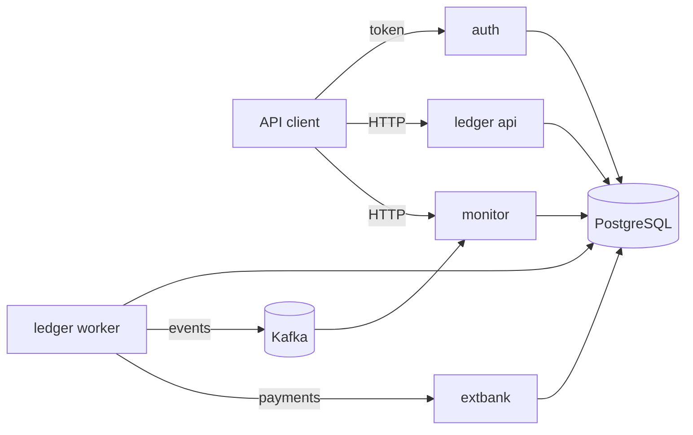

# Tally

Tally is a double-entry ledger service with holds, scheduled payments, and payments to a simulated external bank, built so that ten stated invariants hold under concurrent transfers, process kills, connection faults, and client retries. I wrote test suites that try to break each invariant and kept working until they no longer could.


## How it works

Money lives in accounts, and every movement is a transaction of at least two entries whose debits equal their credits. Entries are never updated or deleted, and each account also stores its balance, written in the same database transaction as its entries. I put as many rules as I could into PostgreSQL itself: a deferred trigger checks at commit that a transaction balances, a check constraint keeps the available balance above the account's limit, triggers and missing privileges make entries append-only, and unique constraints allow one transaction per request key. A separate command checks all ten invariants with one query each.

Every request that moves money carries an `Idempotency-Key`. The key row is the first insert of the posting transaction, so the key, the entries, the balances, and the stored answer commit together or not at all. A retry with the same key gets the stored answer, including a stored rejection, and a concurrent duplicate waits on the unique index until the first request commits.

Concurrent posting has three implementations behind one interface, chosen by a setting: pessimistic row locks in a fixed order, optimistic version checks with retries, and PostgreSQL's serializable isolation with retries. I measured all three on the same workloads instead of picking one up front.

On top of posting there are holds that reserve money without moving it, a scheduler for standing orders, and external payments that run as a sequence of committed steps against a bank simulator, with status queries instead of resubmits when the outcome is unknown. Each transaction writes an outbox row that a single relay publishes to Kafka, and a monitoring service consumes those events, applies three rules on event time, and opens cases. Every change writes an audit row, and a sealer links the rows into a hash chain that a command can verify.

The proof suites run the real services in containers. A property test compares the ledger with an independent in-memory model over random operation sequences. A concurrency suite sends many concurrent operations per strategy and checks the invariants afterwards. Fault scenarios kill processes, cut database connections, slow the database, restart the broker, and make the bank misbehave while load runs. A deliberately broken strategy with no locking is run through the same concurrency suite to show that the suite catches it.



The tables, the invariants and where each one is enforced, and the design of each part are in [docs/architecture.md](docs/architecture.md).

## Running it

You need JDK 21 and Docker with at least 8 GB of memory. All commands run in a POSIX shell (Git Bash on Windows) from the repository root.

```sh
sh task.sh setup    # writes a local .env with generated secrets and compiles everything
sh task.sh check    # lint, unit, integration, and proof suites at CI size, about 30 minutes
sh task.sh run      # starts the stack on localhost
sh task.sh demo     # runs the scripted demo against the stack and checks every step, a few minutes
sh task.sh eval     # runs every measurement at full size and writes build/eval/results.json, about 12 hours
```

## Results

I measured these with `sh task.sh eval` on one desktop machine with Docker Desktop, using the full size profile, and the renderer copied them from the results file.

<!-- results:start -->

| Measure | Result |
| --- | --- |
| Concurrent operations per strategy | 1000000 |
| Invariant violations after those runs | 0 |
| Fault scenarios run | 11 scenarios x 20 runs x 3 strategies = 660 |
| Duplicate postings in fault runs | 0 |
| Duplicate scheduled payments (scenario 6) | 0 |
| External payments | 2000 (settled 66.5%, compensated 17.0%, manual review 16.5%, failed 0.0%) |
| Money created or lost in those payments | 0 minor units |
| Events missing after relay and broker faults | 0 (duplicate deliveries: 265984) |
| Reconciliation breaks found with the right type | 300 of 300 (false breaks on 20 unaltered files: 0) |
| Monitoring precision / recall, R1 | 1.00 / 1.00 |
| Monitoring precision / recall, R2 | 1.00 / 1.00 |
| Monitoring precision / recall, R3 | 1.00 / 1.00 |
| Alert difference with every event delivered twice | 0 |
| Audit rows per state change | 1 |
| Tampered audit rows detected | 20 of 20 |
| Recovery after API kill, median | 5305.6284 ms |
| Recovery after database restart, median | 1387.8764 ms |
| Property test sequences per strategy | 500 sequences of 100 operations |
| Mutation score, ledger core | 99.3% (141 of 142 mutants) |
| Tests | 526 |
| Naive baseline: violations found | 659 (double-posted pairs: 969) |

Measured at commit f29fba2 on 2026-10-20. Reproduce with: sh task.sh eval

<!-- results:end -->

The throughput and latency comparison of the three strategies is in the concurrency section of [docs/architecture.md](docs/architecture.md).

## Limitations

- There is a single PostgreSQL instance and a single Kafka broker, with no replication or failover.
- A transfer moves one currency, and there is no exchange between currencies.
- A frozen account cannot be unfrozen, only closed.
- Payments that end in manual review have no endpoint to resolve them, so their money stays in the clearing account.
- A balance as of a past instant is stable only once every transaction before that instant has committed.
- The audit chain does not detect removal of its newest rows together with their chain links.
- Idempotency keys never expire.
- `extbank` is a simulator. Nothing in this project talks to a real bank.

## What I'd do next

- Run PostgreSQL with a replica and Kafka with three brokers, then add fault scenarios for failover.
- Expire idempotency keys after a retention period without losing the guarantee for keys still in use.
- Add transfers between currencies with exchange rates posted through a conversion account.
