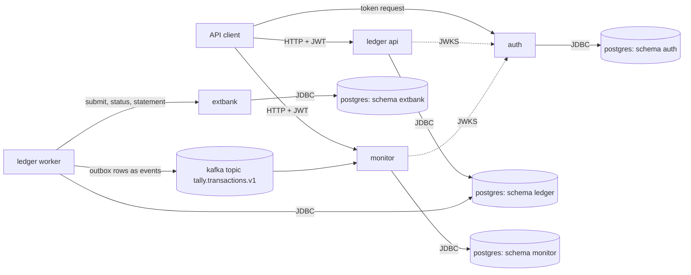
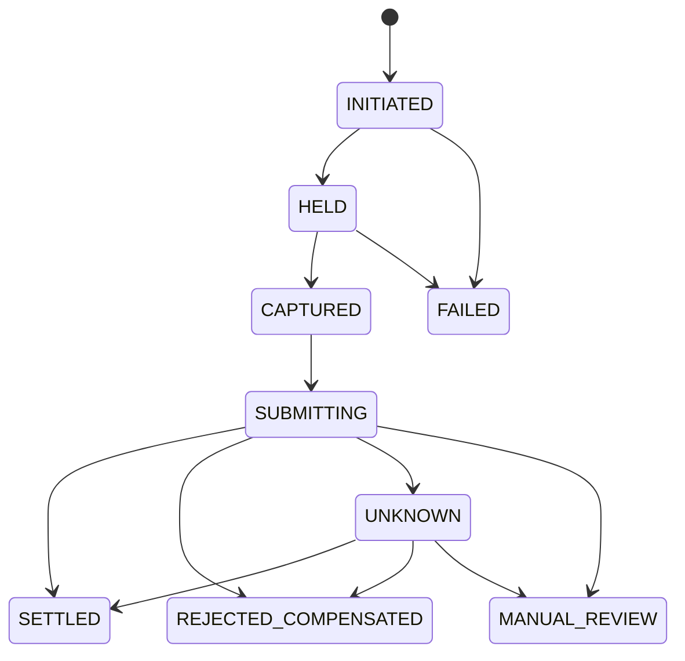

# Architecture

## Overview

Tally is a small bank core. It has 4 services, and each one is a Spring Boot application in its own container.

- `ledger` keeps accounts and posts money movements as double-entry transactions. One image runs in two configurations: the API role serves the HTTP API, and the worker roles run background jobs.
- `auth` issues client-credentials access tokens and publishes the keys that the other services use to check them.
- `monitor` reads the stream of posted transactions, applies its rules, and serves a queue of cases.
- `extbank` simulates the bank on the other side of an external payment.

PostgreSQL is the only data store. Every service has its own schema and its own database role, and no service reads the schema of another. Kafka carries one topic of transaction events from the ledger to the monitor.

The rest of this document covers the tables, the rules that must always hold, how a repeated request is handled, the three ways I implemented concurrent posting, and then the parts built on top of posting: holds, scheduled payments, external payments, the event stream, reconciliation, the audit chain, and monitoring.

## Schema

All amounts are whole numbers of minor units in a `bigint`. Times are `timestamptz(6)`. These are the tables of the posting path.

`account` holds one row per account.

| Column | Purpose |
|---|---|
| `id` | UUID version 7, the primary key. Its order is the lock order. |
| `kind` | `CUSTOMER`, `SETTLEMENT`, or `CLEARING`. There is one settlement and one clearing account per currency. |
| `currency` | Three-letter code. An entry must have the currency of its account. |
| `normal_side` | `DEBIT` or `CREDIT`, the side on which the balance grows. |
| `min_balance` | The lowest available balance a customer account may reach (0 or a negative overdraft limit). |
| `status` | `OPEN`, `FROZEN`, or `CLOSED`. |
| `balance` | The stored balance. It always equals the signed sum of the account's entries. |
| `held` | The amount reserved by holds. Available balance is `balance - held`. |
| `version` | Grows by 1 with every write. The optimistic strategy compares it. |
| `created_at`, `updated_at` | Row times. |

`ledger_transaction` holds one row per posted transaction and is never updated.

| Column | Purpose |
|---|---|
| `id` | UUID version 7, the primary key. |
| `kind` | What was posted: a deposit, a withdrawal, a transfer, a reversal, and the kinds used by holds and external payments. |
| `currency`, `amount` | The total moved. `amount` is above 0. |
| `idempotency_key_id` | The key row of the request that created it. Unique, so one key creates at most one transaction. |
| `reverses_id` | The transaction this one reverses. Unique, so a transaction is reversed at most once. Present exactly when `kind` is `REVERSAL`. |
| `description`, `client_id`, `request_id` | Who asked and why. |
| `posted_at` | The posting time. |
| `created_xid` | The ID of the database transaction that inserted the row. A trigger uses it to reject entries added later. |

`entry` holds the debit and credit lines of a transaction and is never updated.

| Column | Purpose |
|---|---|
| `id` | Identity column. Entries of one account ascend in commit order. |
| `transaction_id` | The transaction the line belongs to. |
| `account_id`, `currency` | The account, with a foreign key on both columns so that the currencies must match. |
| `side` | `DEBIT` or `CREDIT`. |
| `amount` | Above 0. |
| `posted_at` | Copied from the transaction, for balance queries at a point in time. |

`idempotency_key` holds one row per client and key.

| Column | Purpose |
|---|---|
| `id` | Identity column. |
| `client_id`, `key` | Unique together. |
| `request_hash` | SHA-256 of the canonical request, to detect a key reused for a different request. |
| `status_code`, `response_body` | The stored answer that a repeat of the request gets. |
| `created_at` | Row time. |

`outbox` holds one row per transaction, written in the same database transaction. A worker publishes the rows as events and sets `published_at`.

| Column | Purpose |
|---|---|
| `id` | Identity column, the publishing order. |
| `event_id` | The ID the consumer uses to drop duplicates. |
| `transaction_id` | Unique, one event per transaction. |
| `key_account_id` | The partition key of the event. |
| `request_id`, `payload` | The event content. |
| `created_at`, `published_at` | When it was written and when it was sent. |

`audit_log` holds one row per state change and per denied request, and is never updated.

| Column | Purpose |
|---|---|
| `id`, `occurred_at` | ID and time of the row. |
| `actor`, `actor_role`, `scopes` | Who acted, taken from the token. |
| `action`, `resource_type`, `resource_id` | What was done to what. |
| `outcome`, `reason` | `SUCCESS` or `DENIED`, and why. |
| `transaction_id` | The transaction the row belongs to, unique when present. |
| `request_id` | The request that caused it. |
| `row_hash` | SHA-256 of the row content. |

`audit_pending` holds the IDs of audit rows that are not sealed yet. A trigger on `audit_log` inserts one row per new audit row, and the sealer deletes it. `audit_chain` holds one row per sealed audit row and is never updated.

| Column | Purpose |
|---|---|
| `seq` | Position in the chain, without gaps. |
| `audit_id` | The audit row, unique. |
| `prev_hash`, `chain_hash` | The previous link and SHA-256 over it and the audit row's `row_hash`. |
| `sealed_at` | When the sealer wrote the link. |

The ledger schema has more tables for the features built on posting.

| Table | Content | Constraints that carry rules |
|---|---|---|
| `hold` | One row per hold: account, amount, state (`ACTIVE`, `CAPTURED`, `RELEASED`, `EXPIRED`), expiry time, captured amount, capture transaction. | `hold_capture_shape` ties the state `CAPTURED` to a captured amount and a capture transaction; `hold_capture_range` keeps the captured amount between 1 and the hold amount; the capture transaction is unique. |
| `hold_event` | One row per placement, capture, release, or expiry, with its audit row. Never updated. | A partial unique index allows one `PLACED` row and one final row per hold. |
| `schedule` | One row per standing order: accounts, amount, frequency (`ONCE`, `DAILY`, `WEEKLY`, `MONTHLY`), start, optional day of month and end date, status. | Check constraints on the monthly and once shapes, and source and destination must differ. |
| `schedule_occurrence` | One row per due date of a schedule: state (`PENDING`, `POSTED`, `FAILED`, `SKIPPED`), attempts, next attempt time, posted transaction. | `occurrence_uq` on schedule and date; the transaction is unique; `POSTED` exactly when a transaction is set. |
| `external_payment` | One row per outgoing payment: source account, amount, creditor account, external reference, state, hold, capture and resolution transactions, value date, status query count, lease. | The state list; a settled payment has a value date and a resolution transaction; a compensated payment has a resolution transaction. |
| `payment_event` | One row per state change of a payment, with its audit row. Never updated. | The audit ID is unique. |
| `recon_run` | One row per reconciliation run: business date, SHA-256 of the file, status, counts, previous run of the same date, and the line and reason of a malformed file. | `recon_run_file_uq` on date and file hash. |
| `recon_break` | One row per break of a run: type, reference, line number, and the ledger and statement values. | `recon_break_uq` on run and reference. |

The other services have their own schemas. `monitor` has `processed_event` (event IDs already handled), `movement` (one row per customer account touched by an event), `alert`, `case_file`, and the append-only `case_event`. `extbank` has `payment` (what the simulated bank received and how it answered) and `rule` (the behaviour configured for a creditor account). `auth` has `api_client` (client ID, bcrypt hash of the secret, role) and the append-only `client_event`.

## Invariants

These statements must hold after every committed database transaction. Where I could, I enforced each one twice: in the database, so that a bug in the application cannot commit a wrong state, and in the application, so that the client gets a clear error before the database has to refuse. A separate command, `check-invariants`, verifies all of them with one query each.

| ID | Statement | Database enforcement | Application enforcement |
|---|---|---|---|
| I1 | Every transaction balances: at least 2 entries, debits equal credits, both equal the amount, one currency. | Deferred constraint trigger `ledger_transaction_balanced`, which runs at commit. | `Posting.of` refuses to build an unbalanced posting. |
| I2 | No customer account is below its limit. | Check constraint `account_above_limit` on `(balance - held) >= min_balance`. | `Balances.requireWithinLimit`, which answers `INSUFFICIENT_FUNDS`. |
| I3 | No entry or transaction row is updated or deleted. | Triggers `*_no_update` and `*_no_truncate`. The role `ledger_app` has no UPDATE or DELETE privilege on `ledger_transaction` and `entry`. Trigger `entry_parent` rejects an entry whose transaction was inserted by another database transaction. | No code path issues UPDATE or DELETE on these tables. A correction is a reversal, which is a new transaction. |
| I4 | Every stored balance equals the sum of the account's entries. | None. The checker verifies it. | `LedgerWriter.post` writes the balance and the entries in one database transaction. |
| I5 | At most one transaction per idempotency key. | Unique constraints `idempotency_key_uq` and `ledger_transaction_key_uq`. | `IdempotentExecutor`. |
| I6 | No customer account has an available balance below its limit, and the stored `held` equals the sum of its active holds. | Check constraint `account_above_limit` includes `held`. | `HoldRules.requirePlaceable`, and every change of `held` is written in the same database transaction as the hold row it belongs to. |
| I7 | A hold is captured, released, or expired at most once, and never captured above its amount. | Partial unique index `hold_event_final_uq`, check constraints `hold_capture_shape` and `hold_capture_range`, unique `capture_transaction_id`. | `HoldRules.requireCapturable` and a guarded update that only changes a hold whose state is still `ACTIVE`. |
| I8 | Each occurrence of a schedule posts at most one transaction. | Unique constraint `occurrence_uq`, unique `transaction_id`, and the unique idempotency key `sched:<schedule>:<date>`. | `ScheduleRunner` claims the key before it posts. |
| I9 | Every payment is in exactly one state, and each clearing account holds exactly the money of the payments that left a customer account but are not settled or compensated. | The state check, `payment_settled_shape`, and `payment_compensated_shape`. The clearing balance itself is verified by the checker. | `PaymentFlow.allowed` and transitions that update a payment only when it is still in the expected state. |
| I10 | Every posted transaction has exactly one event, and every published event belongs to a transaction. | Unique `outbox.transaction_id`, and the outbox row is inserted in the posting database transaction. | `LedgerWriter.post`. The relay marks a row published only after the broker acknowledged it, and `check-invariants --topic-check` compares the outbox with the topic. |
| A1 | Exactly one audit row per state change. | Unique index on `audit_log.transaction_id`, and unique, required `audit_id` columns on `hold_event` and `payment_event`. The audit row is inserted in the database transaction of the change. | `LedgerWriter.post` writes the audit row after the entries, and every other change writes its row through `AuditWriter` in the same unit of work. |

I4 has no database enforcement because a trigger that sums all entries of an account on every write would cost more with every transaction the account has. The stored balance is what makes the limit check cheap, so I accepted that its correctness rests on the single write path and on the checker.

## Idempotency

Every request that moves money carries an `Idempotency-Key` header. The key is scoped to the client that sent it.

The first statement of the posting database transaction inserts the key row with `ON CONFLICT DO NOTHING`. The entries, the stored balances, the outbox row, the audit row, and the response stored in the key row then commit together or not at all. There is no moment where the key is recorded but the money has not moved, or the other way around, so a crash at any point leaves either nothing or everything.

When two requests with the same key arrive at the same time, the second insert waits on the unique index until the first one commits or rolls back. I bound that wait with `lock_timeout` (5 s by default). After the wait there are three cases.

1. The insert returned a row. This request owns the key. It does the work and stores its status code and body in the key row. The answer is `201` for a posted transaction.
2. The key exists with the same request hash. The stored status code and body are returned unchanged, with the header `Idempotent-Replay: true`. Nothing is posted.
3. The key exists with a different request hash. The answer is `422 IDEMPOTENCY_KEY_REUSED`, and the stored answer is left as it is.

If the wait runs into the timeout, the answer is `409 REQUEST_IN_FLIGHT` with `Retry-After: 1`.

A rejection by a ledger rule, for example `422 INSUFFICIENT_FUNDS`, is stored like a success. The work runs inside a savepoint. On a rule error I roll back to the savepoint, write the error into the key row, and commit. I store rejections because a rejection is a decision made about that request against the state at that moment. If it were not stored, a client that retried after a lost response could see the same key refused once and posted later, and it could not tell which of the two answers was real.

`503 RETRY_EXHAUSTED`, `409`, and `500` are not stored. In these cases every attempt rolled back, including the key row, so nothing was decided. The client may send the same key again and the request runs as if it were new.

## Concurrency strategies

Two transfers that touch the same account at the same time must not both read the old balance and both write. I implemented three ways to prevent that behind one interface, selected by the setting `tally.ledger.strategy`. All three run the same posting code: load the accounts, check the rules, write the new balances in ascending account ID order, insert the transaction and its entries. A failed attempt rolls back completely and is retried after a randomized backoff, at most 10 attempts, and then the answer is `503 RETRY_EXHAUSTED`. The response header `X-Tally-Attempts` reports how many attempts a request took.

The two workloads in the comparison send single transfers between 1000 accounts. In the uniform workload source and destination are picked evenly, so two transfers rarely share an account. In the hot workload 80 percent of the transfers take their source from the same 10 accounts, so most transfers compete with others.

### Pessimistic

Isolation level READ COMMITTED. The accounts are read with `SELECT ... ORDER BY id FOR UPDATE`, so a posting holds the row locks of all its accounts before it looks at a balance. The write is a plain UPDATE. Because every posting takes its locks in the same order, two postings cannot wait on each other in a cycle. What is retried is a deadlock report (`40P01`) or a lock wait that passed `lock_timeout` (`55P03`), and with ordered locking neither happens in normal operation.

Under the uniform workload locks are almost always free, and the cost is one row lock per account. Under the hot workload the postings on a hot account form a queue. Each one waits, then runs once and succeeds. No work is thrown away, so throughput on a hot account is close to one posting after the other, and the waiting shows up as latency instead of retries.

### Optimistic

Isolation level READ COMMITTED. The accounts are read without a lock. The write is `UPDATE ... WHERE id = ? AND version = ?` with the version that was read. If another posting committed a write to that account in between, the UPDATE changes 0 rows, the attempt rolls back, and the posting is retried from the read.

Under the uniform workload a version conflict is rare and no posting waits for a lock it does not need. Under the hot workload many postings read the same version of a hot account, one of them commits, and the others have done their checks and their first writes for nothing. The wasted work grows with the number of clients, and so does the number of attempts per request. The backoff spreads the retries, but a posting on a hot account can lose several times in a row.

### Serializable

Isolation level SERIALIZABLE, which in PostgreSQL is serializable snapshot isolation. The accounts are read without an explicit lock and written with a plain UPDATE. The database tracks what each transaction read with predicate locks and aborts one transaction with a serialization failure (`40001`) when the reads and writes of concurrent transactions could not have happened in any serial order. Two postings that update the same account row conflict directly: the second one fails as soon as the first commits. The application retries the failed attempt.

This strategy needs the least code, because the database decides what a conflict is. The price is that the database may abort more than is necessary. Predicate locks are kept per row at first and are combined into page locks when there are many of them, and a page of the account table holds many accounts. Under the uniform workload this causes some retries between postings that share no account. Under the hot workload it behaves like the optimistic strategy, with wasted attempts on the hot accounts, plus those additional aborts.

<!-- comparison:start -->

| Strategy | Workload | Clients | Transfers/s | p50 ms | p99 ms | Retries | Exhausted |
| --- | --- | ---: | ---: | ---: | ---: | ---: | ---: |
| pessimistic | uniform | 8 | 518.6 | 13.9 | 35.2 | 0 | 0 |
| pessimistic | uniform | 32 | 1240.7 | 22.9 | 71.5 | 0 | 0 |
| pessimistic | uniform | 128 | 1391.7 | 88.1 | 212.1 | 0 | 0 |
| pessimistic | hot | 8 | 161.0 | 10.2 | 17.1 | 0 | 0 |
| pessimistic | hot | 32 | 331.6 | 18.5 | 40.8 | 0 | 0 |
| pessimistic | hot | 128 | 357.9 | 70.6 | 192.7 | 0 | 0 |
| optimistic | uniform | 8 | 612.1 | 12.4 | 22.8 | 321 | 0 |
| optimistic | uniform | 32 | 1293.7 | 22.5 | 63.2 | 3050 | 0 |
| optimistic | uniform | 128 | 1364.3 | 84.8 | 253.5 | 5044 | 0 |
| optimistic | hot | 8 | 158.4 | 10.4 | 17.9 | 52 | 0 |
| optimistic | hot | 32 | 385.1 | 16.0 | 33.1 | 575 | 0 |
| optimistic | hot | 128 | 424.5 | 60.2 | 161.4 | 920 | 0 |
| serializable | uniform | 8 | 355.6 | 14.4 | 114.1 | 8374 | 12 |
| serializable | uniform | 32 | 346.0 | 49.8 | 467.6 | 23809 | 616 |
| serializable | uniform | 128 | 319.9 | 245.6 | 1148.9 | 26092 | 1107 |
| serializable | hot | 8 | 130.2 | 11.3 | 39.9 | 5680 | 10 |
| serializable | hot | 32 | 193.2 | 21.1 | 231.6 | 16001 | 62 |
| serializable | hot | 128 | 168.7 | 95.4 | 977.4 | 21542 | 395 |

Median of 5 runs of 30 seconds each, on AMD64 Family 25 Model 33 Stepping 2, AuthenticAMD, 12 cores, 32694 MB, Docker limit 15955 MB.

<!-- comparison:end -->

## Holds

A hold reserves money on an account without moving it, the way a card authorization does. The account keeps two numbers: `balance`, the sum of its entries, and `held`, the sum of its active holds. The amount a customer can spend is the available balance, `balance - held`, and the limit check of I2 and I6 is written against it, so a hold and a transfer can never together take an account below its limit.

Placing a hold raises `held` and inserts the hold row in one database transaction. Capturing it posts a transaction from the held account to the destination for up to the hold amount and lowers `held` by the full hold amount in the same posting, so any part that was not captured becomes available again. Releasing it only lowers `held`. Each of these writes a `hold_event` row, and a partial unique index on that table allows only one final event per hold. Two captures of the same hold that race each other cannot both commit: the second one finds the hold no longer `ACTIVE`, or fails on the index.

Every hold has an expiry time at most 7 days ahead. A worker job selects due holds and expires each one in its own short database transaction, using the same steps as a release with the state `EXPIRED` and the actor `job:expiry`. A hold that was captured or released between the select and the update is skipped.

## Scheduler

A schedule is a standing order: a transfer of a fixed amount, once, daily, weekly, or monthly, from a start time until an optional end date. Each due date is a row in `schedule_occurrence`. Only one occurrence of a schedule is pending at a time, and the next one is inserted when the current one reaches a final state.

The scheduler job claims one due occurrence with `SELECT ... FOR UPDATE OF o SKIP LOCKED`, so several workers can run it without taking the same row, and handles it in one database transaction. It first claims an idempotency key derived from the schedule and the date, `sched:<schedule id>:<date>`, and only then posts the transfer. If a worker dies after posting but before its commit, nothing of that attempt remains. If it dies after the commit, the next worker finds the key and the transaction it belongs to, and marks the occurrence posted without posting again. The unique constraint on schedule and date and the unique transaction reference back this up in the database.

When the source account has too little money, the occurrence is retried later, up to 3 retries, and then marked `FAILED`. Any other rule failure, such as a frozen account, fails it at once. After downtime the job works through the missed occurrences one at a time in date order, because each one creates the next. An occurrence more than 7 days late is marked `SKIPPED` instead of being posted, so a long outage does not end in a burst of old payments.

## External payments

An external payment sends money from a customer account to an account at another bank, here the `extbank` simulator. It is a sequence of steps, each one a database transaction, run by the orchestrator job on a worker: place a hold on the source account, capture it into the clearing account of the currency, mark the payment `SUBMITTING`, call the bank, and then settle (move the money from clearing to the settlement account) or compensate (move it back to the customer). While a payment is between capture and its final step, its money sits in the clearing account, and invariant I9 checks that each clearing balance equals the sum of those payments.

The state `SUBMITTING` is written and committed before the call to the bank. That is the point of the design: if the worker dies during the call, the next worker that claims the payment sees `SUBMITTING` and knows the bank may have received it. It moves the payment to `UNKNOWN` and asks the bank for the status of the same external reference, instead of sending a new payment that the bank could execute twice. The reference is derived from the payment ID, so it is the same in every attempt, and the bank treats a second submit with that reference as the same payment. A timeout or a server error from the bank also leads to `UNKNOWN`. Status queries follow a backoff, and after 8 queries without an answer the payment goes to `MANUAL_REVIEW` with its money still in clearing, because neither settling nor compensating would be safe without knowing what the bank did.

Workers claim payments with a lease: a claim sets `lease_owner` and `lease_until`, and another worker takes the payment only after the lease has run out. Every transition is an update that names the expected current state, so if two workers do end up on the same payment, the second update changes no row and that worker stops. The ledger postings of the steps use idempotency keys of the form `pay:<payment id>:<step>`, so a repeated step finds its earlier posting instead of posting twice.

## Outbox and events

Every posted transaction becomes one event on the Kafka topic `tally.transactions.v1`. The ledger does not send to Kafka while it posts. `LedgerWriter.post` inserts an `outbox` row in the posting database transaction, so the event exists exactly when the transaction exists. A relay job on a worker reads unpublished rows in `id` order, sends them, waits for the broker to acknowledge them, and then sets `published_at` on the rows that were acknowledged.

Only one relay runs at a time, because each run holds a PostgreSQL advisory lock, and a second worker with the same role waits. That keeps the order of sends equal to the outbox order. The event key is the account of the first entry line, so all events keyed to one account land on one partition in posting order. Delivery is at least once: if the relay dies after the broker accepted a batch but before it marked the rows, the next run sends them again. Each event carries a unique `event_id`, and the consumer drops an event whose ID it has already processed.

The event payload has a `schema_version` field, now 1, and the topic name ends in `v1`. A consumer ignores and logs an event with a version it does not know. Adding an optional property keeps version 1. Removing or renaming a property, or changing a type, needs version 2 and a new topic, so existing consumers never receive a payload they cannot read.

## Reconciliation

Reconciliation compares the payments the ledger considers settled with the statement file of the bank for one business date. The file is a CSV with one line per payment: reference, creditor account, amount, currency, value date. The match key is the external reference.

Each reference ends in exactly one outcome, checked in this order. A reference on two or more lines is `DUPLICATE_IN_STATEMENT`. A reference on one line with no settled ledger payment is `MISSING_IN_LEDGER`. For a matching payment, a different currency is `CURRENCY_MISMATCH`, else a different amount is `AMOUNT_MISMATCH`, else a value date that differs from the ledger or from the business date is `DATE_MISMATCH`. A settled ledger payment of that date whose reference is on no line is `MISSING_IN_STATEMENT`. The order matters because one bad line can look like several problems, and a reviewer needs one clear reason per reference.

A run is stored with its breaks in one database transaction. Running again with the same date and the same file returns the stored run, which the unique constraint on date and file hash enforces even when two runs start together. A corrected file has a different hash, so it creates a new run that points to the previous run of that date. A malformed file stops at the first bad line and is stored as a `FAILED` run with the line number and the reason, and no breaks, so a bad upload is visible instead of producing a partial result.

## Audit chain

Every state change writes one audit row inside the database transaction of the change, so the row exists exactly when the change does. Each row stores a SHA-256 hash of its own content. The table rejects updates and deletes through triggers, and the application role has no privilege to do either.

Those protections stop the application, not someone with database superuser rights. For that case a sealer job links the rows into a hash chain: it takes the unsealed rows in order and writes for each one a link whose hash covers the previous link's hash and the row's hash. I did not compute the chain inside the posting database transaction. Every posting would have to read the current chain head and write the next one, so all writers would queue on that single row, and under SERIALIZABLE they would abort each other constantly. Sealing afterwards in one job keeps the posting path free of a shared hot row, at the price that the newest rows are unsealed for a short time.

`verify-audit` walks the chain in order and reports the first position where a link is missing, a row's content no longer matches its stored hash, or a link's hashes do not follow from the previous one. Changing, deleting, or reordering any sealed row is detected. What it cannot detect is someone removing the newest rows together with their chain links, because the remaining chain is still consistent. Detecting that would need the chain head stored somewhere the database user cannot change.

## Monitoring

The `monitor` service consumes the event topic and turns each event into movements: one per customer account in a deposit, transfer, or hold capture, marked as incoming or outgoing. For each event it records the event ID, inserts the movements, evaluates the rules, and stores the alerts in one database transaction, and only then acknowledges the record. An event seen twice is skipped by its ID.

All rules use the time the transaction was posted, not the time the event arrived. R1 (velocity) fires on an outgoing transfer when the account made more than 10 outgoing transfers in the 10 minutes ending at it, so the 11th and every later one inside such a window alert. R2 (structuring) fires on an outgoing transfer of at least 900,000 and less than 1,000,000 minor units when the account made at least 3 of those in the 24 hours ending at it. R3 (pass-through) fires on an incoming amount when at least 90 percent of it leaves the account within the 30 minutes after it arrived. The limits are settings, and these are their defaults.

Each rule is a function of the stored set of movements alone, and adding a movement can create alerts but never remove one. An alert is identified by its rule, its account, and the transaction that triggered it, and a unique constraint on those keeps it from being stored twice. When a movement arrives, every alert it could complete is evaluated again, including alerts for transactions that are earlier or later in event time. So the final set of alerts is the same whatever order the events arrive in and however often each is delivered. A new alert joins an open case of the same account and rule from the 24 hours around it, or opens a new case. Which alerts end up grouped in one case can depend on arrival order. The set of alerts does not.

## Other databases

I wrote the ledger for PostgreSQL, and most of the design carries over to Oracle and SQL Server with small changes. Row locking in a fixed order works in both: Oracle has `SELECT <columns> FOR UPDATE`, and SQL Server uses the table hints `WITH (UPDLOCK, ROWLOCK)` for the same purpose. The version column of the optimistic strategy works unchanged, because it only needs an UPDATE that reports how many rows it changed. The serializable strategy does not carry over as it is. Oracle's SERIALIZABLE level is snapshot isolation: it raises ORA-08177 when two transactions write the same row, but it does not detect write skew, so the strategy would need explicit locks there to stay correct. SQL Server's SERIALIZABLE level uses range locks, which block instead of aborting, and it reports a deadlock as error 1205. Under its snapshot isolation level an update conflict is error 3960. The retry code would have to map these errors in place of the PostgreSQL SQLSTATE values. Deferred constraint triggers, which I use to check at commit that a transaction balances, have no direct equivalent on SQL Server. There the balance check would move to a procedure called at commit time or to an indexed view.
