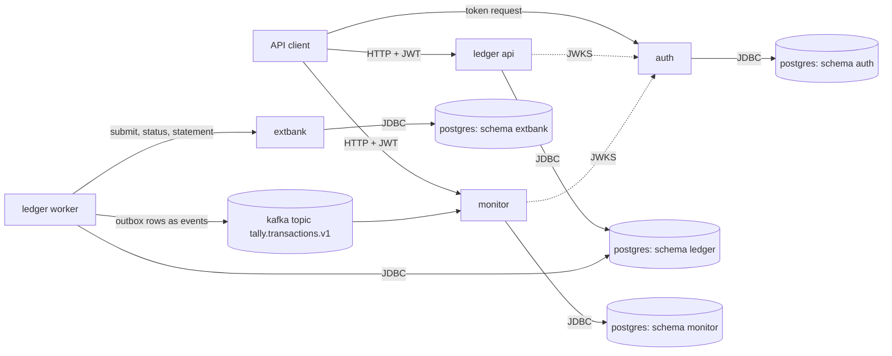

# Architecture

## Overview

Tally is a small bank core. It has 4 services, and each one is a Spring Boot application in its own container.

- `ledger` keeps accounts and posts money movements as double-entry transactions. One image runs in two configurations: the API role serves the HTTP API, and the worker roles run background jobs.
- `auth` issues client-credentials access tokens and publishes the keys that the other services use to check them.
- `monitor` reads the stream of posted transactions, applies its rules, and serves a queue of cases.
- `extbank` simulates the bank on the other side of an external payment.

PostgreSQL is the only data store. Every service has its own schema and its own database role, and no service reads the schema of another. Kafka carries one topic of transaction events from the ledger to the monitor.

The rest of this document is about the posting path of the ledger: the tables, the rules that must always hold, how a repeated request is handled, and the three ways I implemented concurrent posting.

## Schema

All amounts are whole numbers of minor units in a `bigint`. Times are `timestamptz(6)`. These are the tables the posting path uses.

`account` holds one row per account.

| Column | Purpose |
|---|---|
| `id` | UUID version 7, the primary key. Its order is the lock order. |
| `kind` | `CUSTOMER`, `SETTLEMENT`, or `CLEARING`. There is one settlement and one clearing account per currency. |
| `currency` | Three-letter code. An entry must have the currency of its account. |
| `normal_side` | `DEBIT` or `CREDIT`, the side on which the balance grows. |
| `min_balance` | The lowest available balance a customer account may reach (0 or a negative overdraft limit). |
| `status` | `OPEN`, `FROZEN`, or `CLOSED`. |
| `balance` | The stored balance. It always equals the signed sum of the account's entries. |
| `held` | The amount reserved by holds. Available balance is `balance - held`. |
| `version` | Grows by 1 with every write. The optimistic strategy compares it. |
| `created_at`, `updated_at` | Row times. |

`ledger_transaction` holds one row per posted transaction and is never updated.

| Column | Purpose |
|---|---|
| `id` | UUID version 7, the primary key. |
| `kind` | What was posted: a deposit, a withdrawal, a transfer, a reversal, and the kinds used by holds and external payments. |
| `currency`, `amount` | The total moved. `amount` is above 0. |
| `idempotency_key_id` | The key row of the request that created it. Unique, so one key creates at most one transaction. |
| `reverses_id` | The transaction this one reverses. Unique, so a transaction is reversed at most once. Present exactly when `kind` is `REVERSAL`. |
| `description`, `client_id`, `request_id` | Who asked and why. |
| `posted_at` | The posting time. |
| `created_xid` | The ID of the database transaction that inserted the row. A trigger uses it to reject entries added later. |

`entry` holds the debit and credit lines of a transaction and is never updated.

| Column | Purpose |
|---|---|
| `id` | Identity column. Entries of one account ascend in commit order. |
| `transaction_id` | The transaction the line belongs to. |
| `account_id`, `currency` | The account, with a foreign key on both columns so that the currencies must match. |
| `side` | `DEBIT` or `CREDIT`. |
| `amount` | Above 0. |
| `posted_at` | Copied from the transaction, for balance queries at a point in time. |

`idempotency_key` holds one row per client and key.

| Column | Purpose |
|---|---|
| `id` | Identity column. |
| `client_id`, `key` | Unique together. |
| `request_hash` | SHA-256 of the canonical request, to detect a key reused for a different request. |
| `status_code`, `response_body` | The stored answer that a repeat of the request gets. |
| `created_at` | Row time. |

`outbox` holds one row per transaction, written in the same database transaction. A worker publishes the rows as events and sets `published_at`.

| Column | Purpose |
|---|---|
| `id` | Identity column, the publishing order. |
| `event_id` | The ID the consumer uses to drop duplicates. |
| `transaction_id` | Unique, one event per transaction. |
| `key_account_id` | The partition key of the event. |
| `request_id`, `payload` | The event content. |
| `created_at`, `published_at` | When it was written and when it was sent. |

`audit_log` holds one row per state change and per denied request, and is never updated.

| Column | Purpose |
|---|---|
| `id`, `occurred_at` | ID and time of the row. |
| `actor`, `actor_role`, `scopes` | Who acted, taken from the token. |
| `action`, `resource_type`, `resource_id` | What was done to what. |
| `outcome`, `reason` | `SUCCESS` or `DENIED`, and why. |
| `transaction_id` | The transaction the row belongs to, unique when present. |
| `request_id` | The request that caused it. |
| `row_hash` | SHA-256 of the row content. |

## Invariants

These statements must hold after every committed database transaction. Where I could, I enforced each one twice: in the database, so that a bug in the application cannot commit a wrong state, and in the application, so that the client gets a clear error before the database has to refuse. A separate command, `check-invariants`, verifies all of them with one query each.

| ID | Statement | Database enforcement | Application enforcement |
|---|---|---|---|
| I1 | Every transaction balances: at least 2 entries, debits equal credits, both equal the amount, one currency. | Deferred constraint trigger `ledger_transaction_balanced`, which runs at commit. | `Posting.of` refuses to build an unbalanced posting. |
| I2 | No customer account is below its limit. | Check constraint `account_above_limit` on `(balance - held) >= min_balance`. | `Balances.requireWithinLimit`, which answers `INSUFFICIENT_FUNDS`. |
| I3 | No entry or transaction row is updated or deleted. | Triggers `*_no_update` and `*_no_truncate`. The role `ledger_app` has no UPDATE or DELETE privilege on `ledger_transaction` and `entry`. Trigger `entry_parent` rejects an entry whose transaction was inserted by another database transaction. | No code path issues UPDATE or DELETE on these tables. A correction is a reversal, which is a new transaction. |
| I4 | Every stored balance equals the sum of the account's entries. | None. The checker verifies it. | `LedgerWriter.post` writes the balance and the entries in one database transaction. |
| I5 | At most one transaction per idempotency key. | Unique constraints `idempotency_key_uq` and `ledger_transaction_key_uq`. | `IdempotentExecutor`. |
| A1 | Exactly one audit row per state change. | Unique index on `audit_log.transaction_id`. The audit row is inserted in the posting database transaction. | `LedgerWriter.post` writes the audit row after the entries. |

I4 has no database enforcement because a trigger that sums all entries of an account on every write would cost more with every transaction the account has. The stored balance is what makes the limit check cheap, so I accepted that its correctness rests on the single write path and on the checker.

## Idempotency

Every request that moves money carries an `Idempotency-Key` header. The key is scoped to the client that sent it.

The first statement of the posting database transaction inserts the key row with `ON CONFLICT DO NOTHING`. The entries, the stored balances, the outbox row, the audit row, and the response stored in the key row then commit together or not at all. There is no moment where the key is recorded but the money has not moved, or the other way around, so a crash at any point leaves either nothing or everything.

When two requests with the same key arrive at the same time, the second insert waits on the unique index until the first one commits or rolls back. I bound that wait with `lock_timeout` (5 s by default). After the wait there are three cases.

1. The insert returned a row. This request owns the key. It does the work and stores its status code and body in the key row. The answer is `201` for a posted transaction.
2. The key exists with the same request hash. The stored status code and body are returned unchanged, with the header `Idempotent-Replay: true`. Nothing is posted.
3. The key exists with a different request hash. The answer is `422 IDEMPOTENCY_KEY_REUSED`, and the stored answer is left as it is.

If the wait runs into the timeout, the answer is `409 REQUEST_IN_FLIGHT` with `Retry-After: 1`.

A rejection by a ledger rule, for example `422 INSUFFICIENT_FUNDS`, is stored like a success. The work runs inside a savepoint. On a rule error I roll back to the savepoint, write the error into the key row, and commit. I store rejections because a rejection is a decision made about that request against the state at that moment. If it were not stored, a client that retried after a lost response could see the same key refused once and posted later, and it could not tell which of the two answers was real.

`503 RETRY_EXHAUSTED`, `409`, and `500` are not stored. In these cases every attempt rolled back, including the key row, so nothing was decided. The client may send the same key again and the request runs as if it were new.

## Concurrency strategies

Two transfers that touch the same account at the same time must not both read the old balance and both write. I implemented three ways to prevent that behind one interface, selected by the setting `tally.ledger.strategy`. All three run the same posting code: load the accounts, check the rules, write the new balances in ascending account ID order, insert the transaction and its entries. A failed attempt rolls back completely and is retried after a randomized backoff, at most 10 attempts, and then the answer is `503 RETRY_EXHAUSTED`. The response header `X-Tally-Attempts` reports how many attempts a request took.

The two workloads in the comparison send single transfers between 1000 accounts. In the uniform workload source and destination are picked evenly, so two transfers rarely share an account. In the hot workload 80 percent of the transfers take their source from the same 10 accounts, so most transfers compete with others.

### Pessimistic

Isolation level READ COMMITTED. The accounts are read with `SELECT ... ORDER BY id FOR UPDATE`, so a posting holds the row locks of all its accounts before it looks at a balance. The write is a plain UPDATE. Because every posting takes its locks in the same order, two postings cannot wait on each other in a cycle. What is retried is a deadlock report (`40P01`) or a lock wait that passed `lock_timeout` (`55P03`), and with ordered locking neither happens in normal operation.

Under the uniform workload locks are almost always free, and the cost is one row lock per account. Under the hot workload the postings on a hot account form a queue. Each one waits, then runs once and succeeds. No work is thrown away, so throughput on a hot account is close to one posting after the other, and the waiting shows up as latency instead of retries.

### Optimistic

Isolation level READ COMMITTED. The accounts are read without a lock. The write is `UPDATE ... WHERE id = ? AND version = ?` with the version that was read. If another posting committed a write to that account in between, the UPDATE changes 0 rows, the attempt rolls back, and the posting is retried from the read.

Under the uniform workload a version conflict is rare and no posting waits for a lock it does not need. Under the hot workload many postings read the same version of a hot account, one of them commits, and the others have done their checks and their first writes for nothing. The wasted work grows with the number of clients, and so does the number of attempts per request. The backoff spreads the retries, but a posting on a hot account can lose several times in a row.

### Serializable

Isolation level SERIALIZABLE, which in PostgreSQL is serializable snapshot isolation. The accounts are read without an explicit lock and written with a plain UPDATE. The database tracks what each transaction read with predicate locks and aborts one transaction with a serialization failure (`40001`) when the reads and writes of concurrent transactions could not have happened in any serial order. Two postings that update the same account row conflict directly: the second one fails as soon as the first commits. The application retries the failed attempt.

This strategy needs the least code, because the database decides what a conflict is. The price is that the database may abort more than is necessary. Predicate locks are kept per row at first and are combined into page locks when there are many of them, and a page of the account table holds many accounts. Under the uniform workload this causes some retries between postings that share no account. Under the hot workload it behaves like the optimistic strategy, with wasted attempts on the hot accounts, plus those additional aborts.

<!-- comparison:start -->
The eval command writes this table.
<!-- comparison:end -->

## Other databases

I wrote the ledger for PostgreSQL, and most of the design carries over to Oracle and SQL Server with small changes. Row locking in a fixed order works in both: Oracle has `SELECT <columns> FOR UPDATE`, and SQL Server uses the table hints `WITH (UPDLOCK, ROWLOCK)` for the same purpose. The version column of the optimistic strategy works unchanged, because it only needs an UPDATE that reports how many rows it changed. The serializable strategy does not carry over as it is. Oracle's SERIALIZABLE level is snapshot isolation: it raises ORA-08177 when two transactions write the same row, but it does not detect write skew, so the strategy would need explicit locks there to stay correct. SQL Server's SERIALIZABLE level uses range locks, which block instead of aborting, and it reports a deadlock as error 1205. Under its snapshot isolation level an update conflict is error 3960. The retry code would have to map these errors in place of the PostgreSQL SQLSTATE values. Deferred constraint triggers, which I use to check at commit that a transaction balances, have no direct equivalent on SQL Server. There the balance check would move to a procedure called at commit time or to an indexed view.
